# NEXORA AI

**Intelligence That Moves Business Forward.**

A premium enterprise AI company website and a fully interactive AI-operations console, designed and engineered as a frontend and UI/UX showcase.

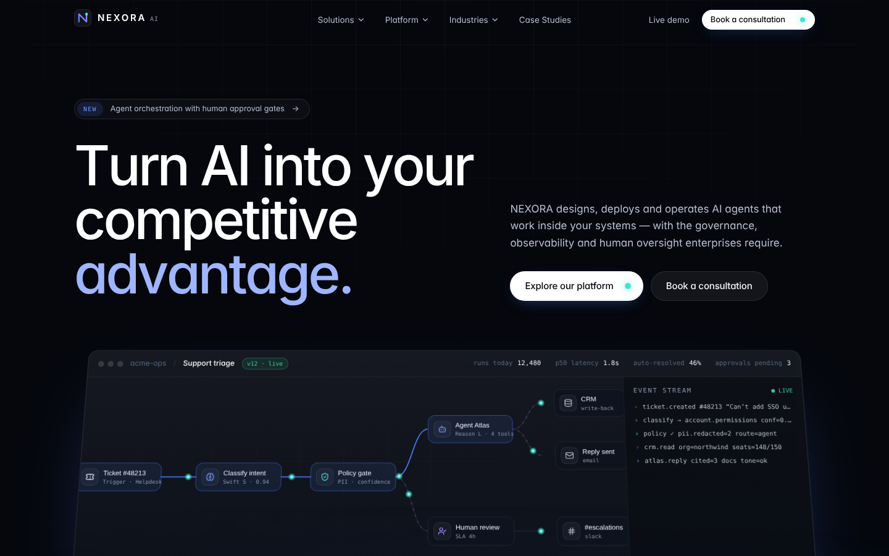

> **Demo notice.** NEXORA AI is a fictional company. All brands, people, testimonials, case studies and metrics are illustrative and clearly labelled as such in the UI. Nothing is a real customer or verified outcome.

---

## Highlights

| | |
|---|---|
| **Live operations console in the hero** | An animated agent pipeline (SVG + SMIL packets, React node state) inside a product frame that tilts flat as you scroll. |
| **Node-based workflow builder** | React Flow canvas with drag-and-drop palette, typed nodes, branching conditions, property editing, validation, animated execution, failure injection, save to `localStorage` and an unsaved-changes guard. |
| **Interactive platform architecture** | A keyboard-operable SVG architecture diagram with animated data bus; selecting a layer drives a detail panel. |
| **Transparent ROI calculator** | Four sliders feed a visible model — hours released, FTE equivalent and payback — with the assumptions stated. |
| **Agent registry** | Search, status tabs, department filter, sort, grid/table views, create/duplicate/pause/delete with undo, agent detail pages with config forms and test runs. |
| **Analytics** | Date presets + custom range, usage trend (chart ↔ table), stacked performance bars, per-agent stats, spend and latency — plus CSV export. |
| **Activity logs** | Debounced search, status & agent filters, page-size control, numbered pagination, trace detail modal — all state in the URL. |
| **⌘K command palette** | Keyboard-driven search across pages, agents, workflows and actions. |
| **Light & dark themes** | Semantic CSS-variable tokens; the console switches at runtime, charts use a palette validated for both. |

## Screenshots

| Marketing | Console |
|---|---|
| 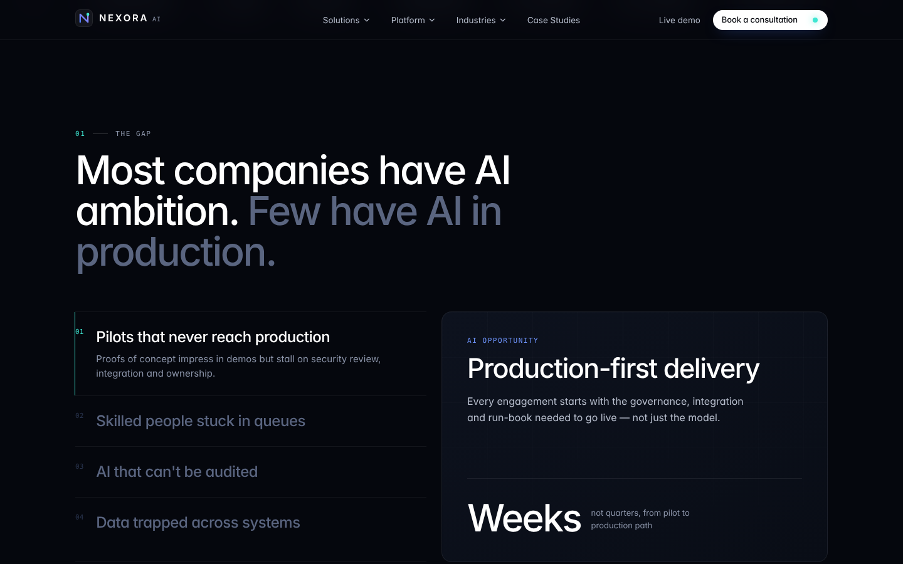 | 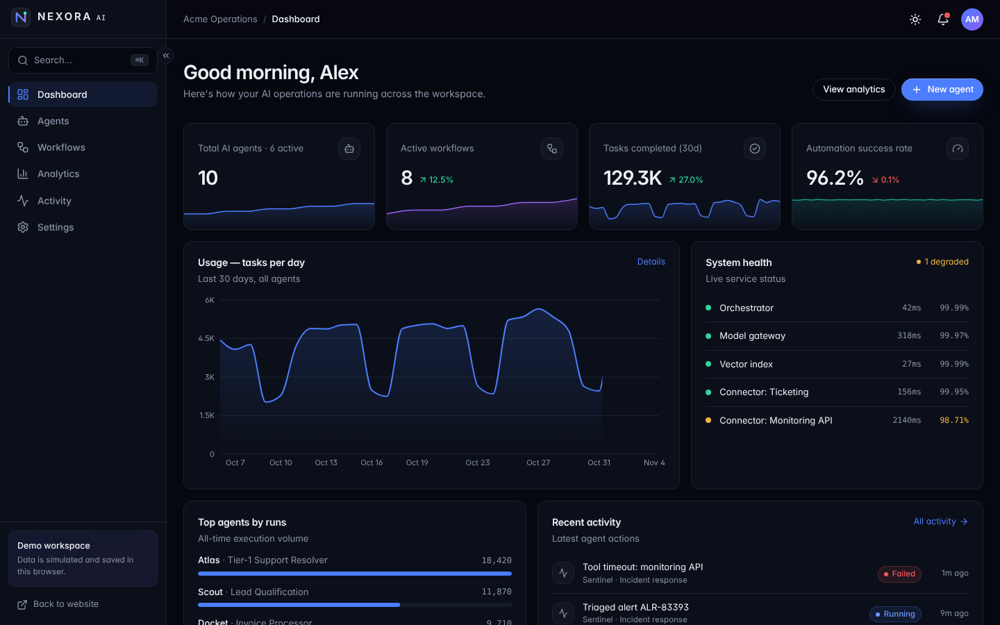 |
| 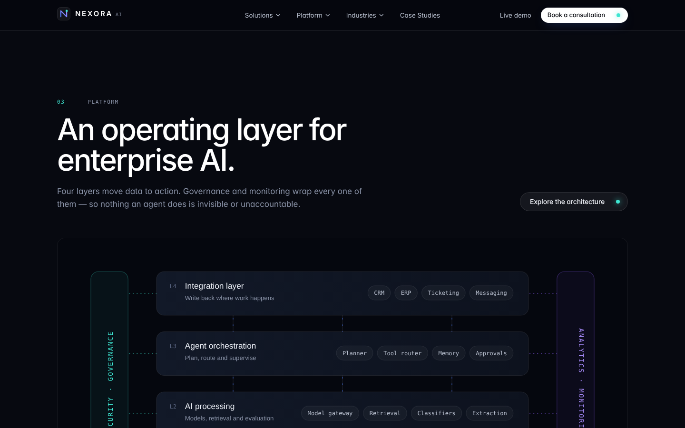 | 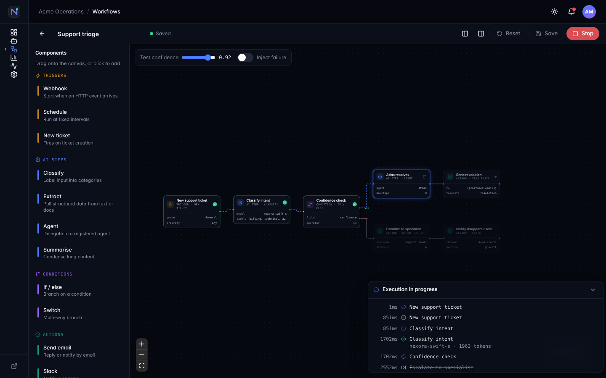 |
| 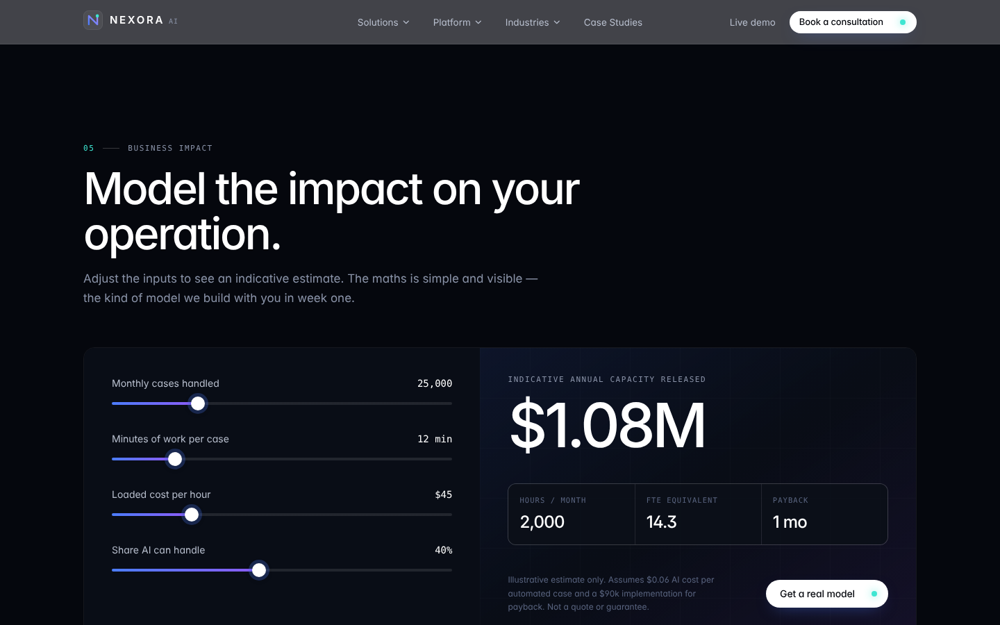 | 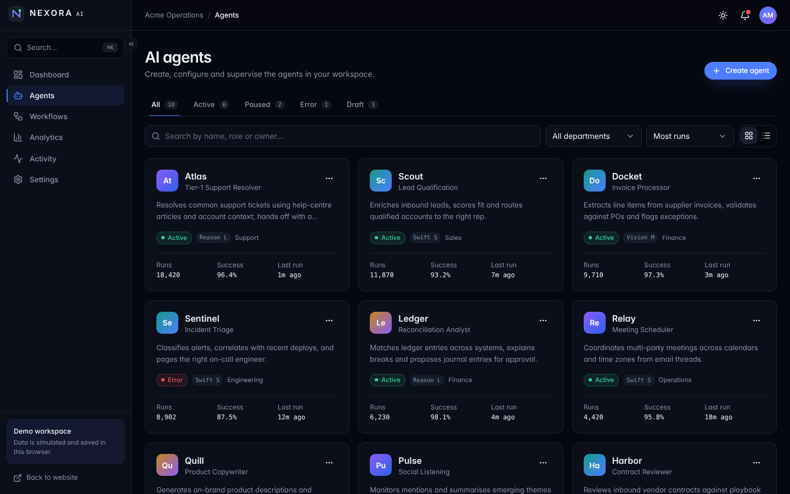 |
| 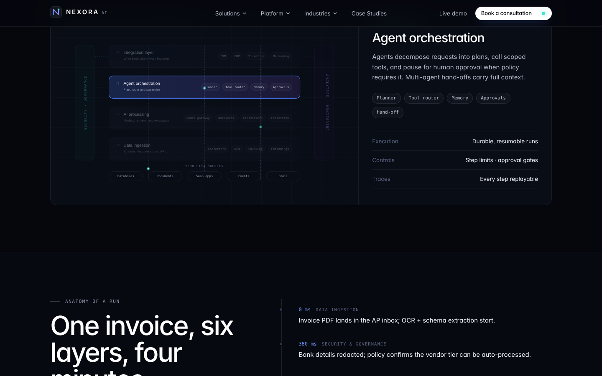 | 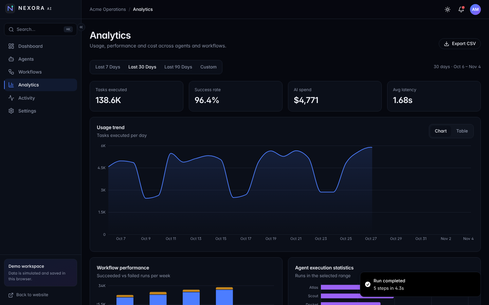 |
| 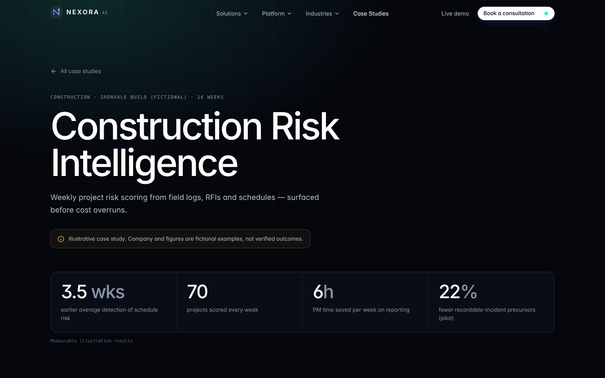 | 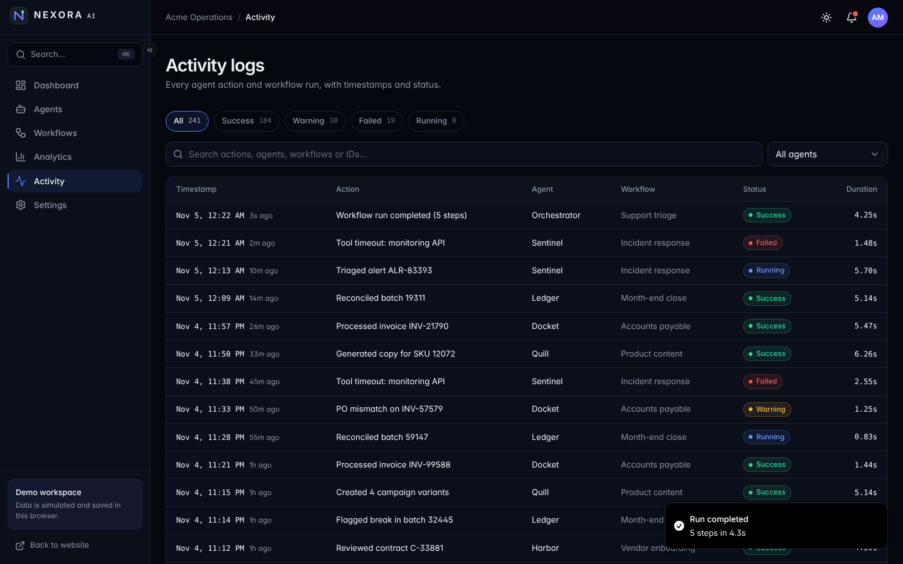 |
| 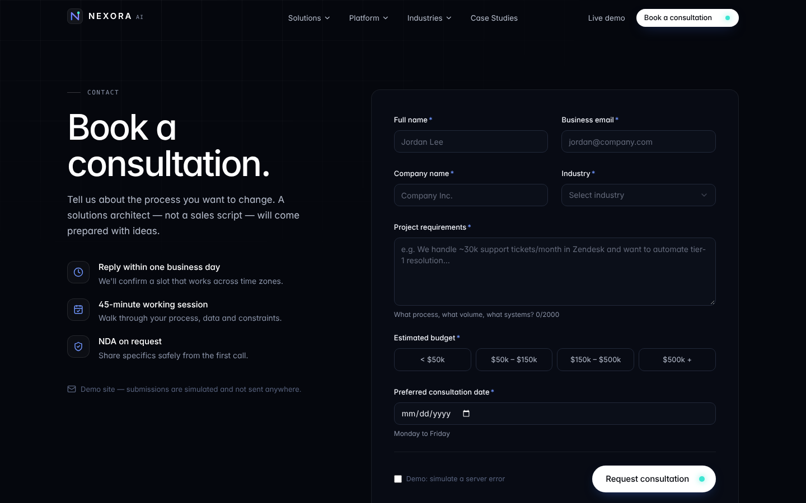 | 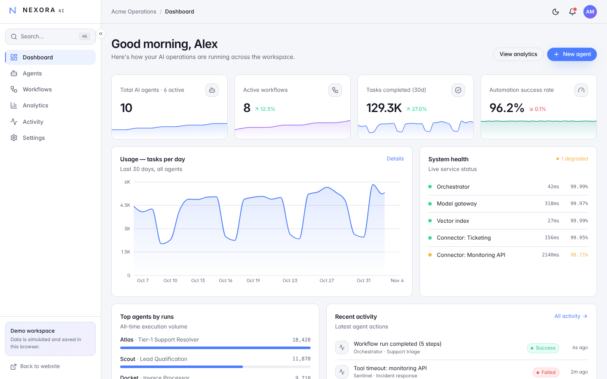 |

Mobile: [home](docs/screenshots/14-mobile-home.png) · [navigation](docs/screenshots/15-mobile-menu.png) · [dashboard](docs/screenshots/16-mobile-dashboard.png)

## Tech stack

React 18 · Vite 5 · TypeScript (strict) · Tailwind CSS 3 · shadcn/ui pattern on Radix primitives · Framer Motion · React Router 6 (data router) · React Flow (`@xyflow/react`) · Recharts · Lucide · React Hook Form · Zod · Sonner

## Getting started

```bash
npm install
npm run dev        # http://localhost:5173
npm run typecheck
npm run build      # production build in dist/
npm run preview    # serve the build
```

Routes use a hash-based data router, so the `dist/` folder deploys to any static host (GitHub Pages, S3, Netlify, Vercel) with no rewrite rules. Open the console at `/#/app/dashboard` — a one-click demo sign-in gates the app routes.

### Deploying

- **Vercel / Netlify:** framework preset *Vite*, build `npm run build`, output `dist`.
- **GitHub Pages:** push `dist/` to a `gh-pages` branch (the build uses relative asset paths, so it works from a sub-path).

## Project structure

```
src/
  App.tsx                 # data router, lazy routes, providers
  styles/                 # tokens.ts (design tokens), globals.css (semantic theme vars)
  components/
    ui/                   # shadcn-style primitives: button, dialog, select, tabs, form-field…
    brand/ motion/        # logo, Reveal, LetterReveal, CountUp
    layout/               # MarketingLayout, AppLayout, Navbar, Footer, guards, error boundary
    marketing/            # page sections, ArchitectureDiagram, home/* hero visuals
    app/                  # console components; workflow/ = node, engine, palette, templates
  pages/marketing/        # Home, Solutions, Platform, Industries, CaseStudies, Contact…
  pages/app/              # Dashboard, Agents, AgentDetail, Workflows, WorkflowBuilder, Analytics…
  data/                   # typed content + deterministic mock data
  store/AppStore.tsx      # app state, persisted to localStorage
docs/
  ARCHITECTURE.md         # technical architecture
  CASE_STUDY.md           # UI/UX case study
  screenshots/
```

## Quality checklist

- `tsc --strict` clean, `noUnusedLocals`/`noUnusedParameters` on
- No console errors across all 18 routes; no horizontal overflow at 375 / 768 / 1280 px
- Route-level code splitting — the marketing site never downloads Recharts or React Flow
- Semantic landmarks, skip link, labelled controls, focus-visible rings, keyboard-operable tabs, menus, diagram and command palette
- `prefers-reduced-motion` respected (CSS, letter reveal, canvas glow and SMIL packets)
- Categorical chart palette validated for colour-vision deficiency and contrast in both themes
- Per-route titles and descriptions, Open Graph tags

See [docs/ARCHITECTURE.md](docs/ARCHITECTURE.md) and [docs/CASE_STUDY.md](docs/CASE_STUDY.md) for depth.

## License

MIT — free to learn from. The NEXORA name and all demo content are fictional.
